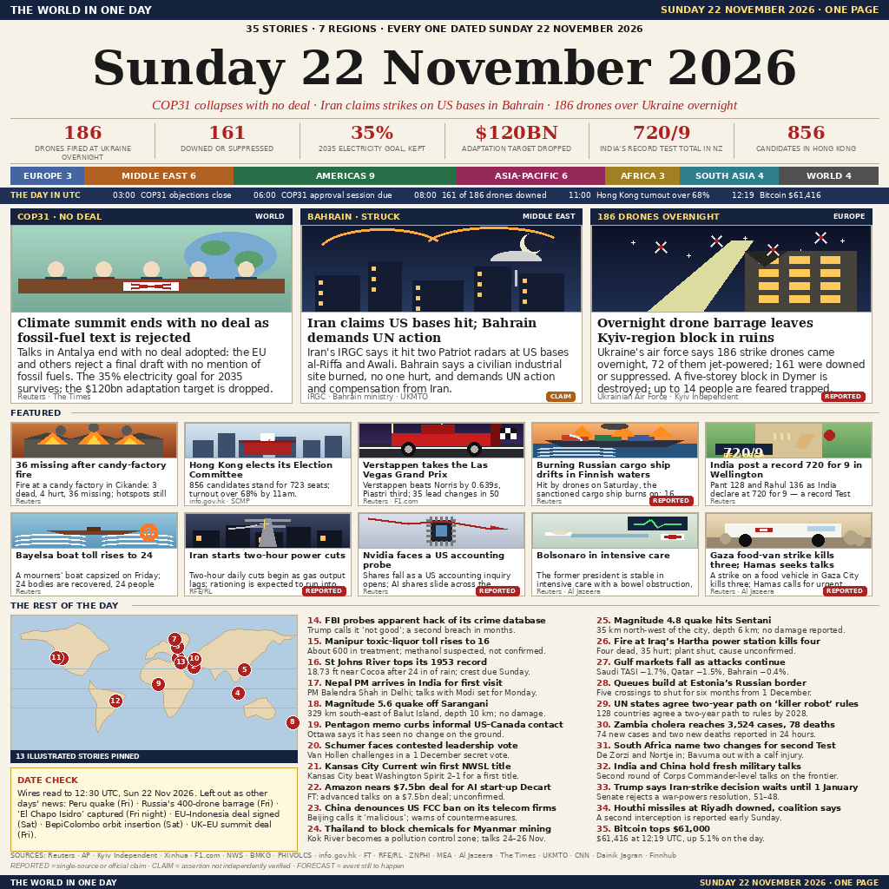

# THE TWENTY-SECOND — Sunday 22 November 2026

[](https://make.fun/bounty/news-image-20261122)
[](https://make.fun/bounty/news-image-20261122)
[](https://make.fun/bounty/news-image-20261122)

One image summing up Sunday 22 November 2026's world news, for the
[make.fun bounty "Sum up 22 November's world news in one image"](https://make.fun/bounty/news-image-20261122).



## What it is

A cream-paper newspaper front page with exactly 35 stories across 7
regions — every one verified as having happened, or first been reported,
on Sunday 22 November 2026. No make.fun story is included, by the
entrant's choice.

- **3 heroes:** COP31 collapses in Antalya with no deal adopted (the
  final draft, with no mention of fossil fuels, rejected by the EU);
  Iran claims strikes on US bases in Bahrain while Bahrain demands UN
  action and compensation; Russia fires 186 drones at Ukraine overnight,
  a five-storey block in Dymer destroyed.
- **10 features (04–13):** the Cikande candy-factory fire (36 missing);
  Hong Kong's Election Committee vote (856 candidates, 723 seats);
  Verstappen's Las Vegas Grand Prix win; the Russian cargo ship Sparta II
  still burning off Finland; India declaring at 720 for 9 in Wellington;
  the Bayelsa boat toll rising to 24; Iran starting two-hour power cuts;
  Nvidia facing a US accounting probe; Bolsonaro in intensive care; a
  Gaza food-van strike killing three as Hamas seeks talks.
- **22 briefs (14–35)** across the Americas, Asia-Pacific, South Asia,
  Europe, the Middle East, Africa and the wider world — from the FBI
  probing an apparent hack of its crime database to Bitcoin topping
  $61,000.
- **Region strip** (Europe 3, Middle East 6, Americas 9, Asia-Pacific 6,
  Africa 3, South Asia 4, World 4 — sums to 35), a 6-number stat strip
  (186 drones, 161 downed, 35% 2035 electricity goal, $120bn adaptation
  target dropped, 720/9, 856 candidates), a UTC timeline strip, a
  numbered world map for the 13 illustrated stories, and a red
  **DATE CHECK** box naming the items that are *not* 22 November news
  (Peru quake, Russia's 400-drone barrage, "El Chapo Isidro" captured,
  EU–Indonesia deal, BepiColombo orbit insertion, UK–EU summit deal).
- Every story carries its source and a certainty label — REPORTED
  (single-source or official claim), CLAIM (assertion not independently
  verified) or FORECAST (event still to happen) — explained in the legend
  at the foot of the page.

All 13 illustrations are simple flat code-drawn scenes — a negotiation
table with a globe and a rejected draft, a night skyline under missile
arcs, drones over a lit apartment block, a burning factory, a ballot box,
a race car under floodlights, a burning cargo ship, a batsman with a
720/9 scoreboard, a capsized boat, a power pylon over a dark city, a
microchip under a falling chart, a hospital bed and monitor, an aid van —
no photos. The layout follows the shared top-3 template but is kept
airy: a giant serif date masthead, wide margins and plain bands, because
the judge's "it reads" criterion preferred the cleaner page. The image
is 218,101 bytes (1024×1024 RGB), drawn deterministically: two runs are
byte-identical.

## Files

- `entry.png` — the image (1024×1024 RGB, 218,101 bytes)
- `generate.py` — the Pillow program that draws it (deterministic)
- `main.py` — the entrypoint: copies `entry.png` to
  `$MAKEFUN_OUTPUT_DIR/entry.png` (stdlib only)
- `transcript.txt` — one line per story with its sources and label, plus
  the excluded other-days items
- `README.md`, `LICENSE` (MIT), `.makefun/owner.json`

## Reproduce

```sh
python3 generate.py   # redraws entry.png, byte-identical every run
mkdir -p out && MAKEFUN_OUTPUT_DIR=out python3 main.py
```

## License

MIT — see [LICENSE](LICENSE).
